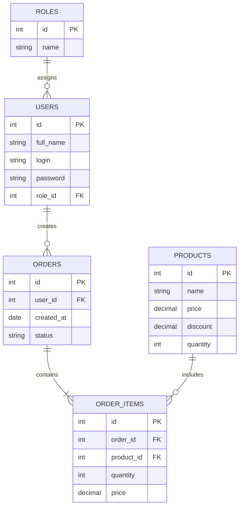

## ER-диаграмма базы данных

База данных ShoeShop предназначена для хранения информации о пользователях, товарах каталога и оформленных заказах.

Основные сущности:
- `users` — сведения о пользователях системы и их учётных записях;
- `roles` — роли пользователей и разграничение прав доступа;
- `products` — информация о моделях обуви, стоимости, скидках и наличии;
- `orders` — информация об оформленных заказах, дате создания и статусе;
- `order_items` — состав заказов, количество и стоимость выбранных товаров.

### Отображение остатка товара

- «Много в наличии» — если количество товара больше 5;
- «Мало в наличии» — если количество товара равно 5 или меньше.

### Связи между сущностями

- Одна роль может быть назначена нескольким пользователям (1:N).
- Один пользователь может оформить несколько заказов (1:N).
- Один заказ может содержать несколько позиций (1:N).
- Один товар может входить в состав нескольких заказов (1:N).

### Структура ER-диаграммы

Диаграмма представляет концептуальную модель данных учебного проекта и демонстрирует основные сущности и связи между ними.
